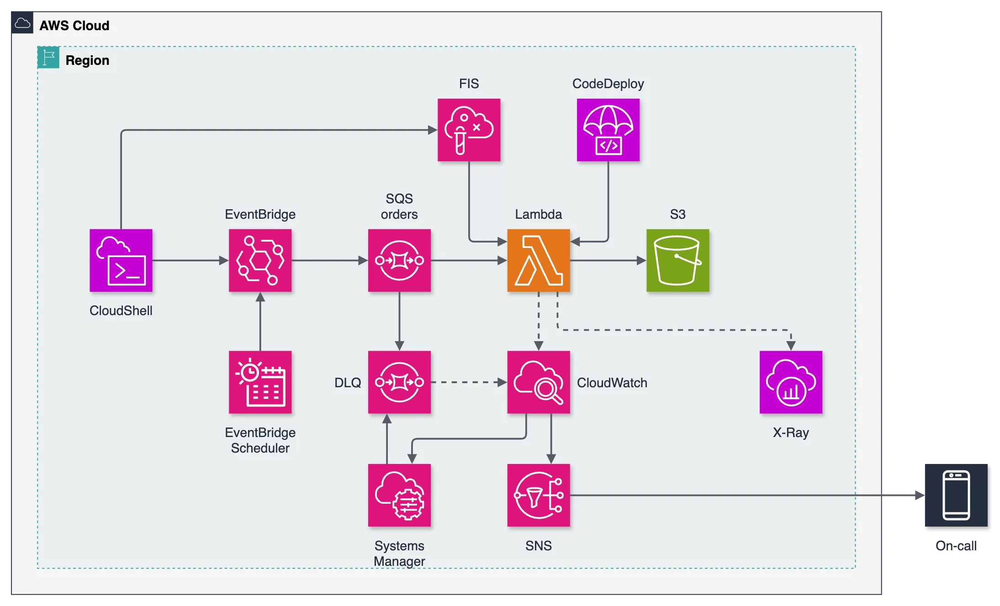

# DevOps 체험하기: 카오스 엔지니어링(AWS FIS)과 온콜 대응(CloudWatch, SNS, OpsCenter)

저장소 `devops-day-lab`.

**일부러 부수고, 지켜보고, 호출을 받고, 고치고, 마지막에는 망가진 버전을 배포해 보는 작은 주문 파이프라인입니다.** `sam deploy` 한 번으로 EventBridge 버스, 데드레터 큐가 붙은 SQS 큐, Lambda 함수 하나, S3 아카이브, 알람 다섯 개가 붙은 CloudWatch 대시보드, AWS FIS 카오스 실험 두 개, SNS 온콜 토픽, OpsCenter 티켓, Systems Manager 런북, CodeDeploy 카나리 배포가 올라갑니다. 온콜 엔지니어가 힘든 한 주에 겪는 일을 55분에 압축했습니다.

[English README](README.md)



- **앱은 의도적으로 단순합니다.** EventBridge Scheduler가 1분에 `OrderPlaced` 이벤트 10개를 버스에 올리고, 규칙이 SQS 큐로 보내고, Lambda 함수가 주문을 S3에 저장합니다. 세 번 실패한 주문은 데드레터 큐로 갑니다.
- **CloudWatch 대시보드로 지켜봅니다.** 호출 수와 오류 수, p50/p95 지연, 큐 깊이, 임베디드 메트릭 포맷 한 줄로 만든 앱 지표, 구조화된 JSON 로그를 봅니다. X-Ray 추적이 켜져 있습니다.
- **AWS Fault Injection Service로 부숩니다.** 한 실험은 4분 동안 모든 주문을 실패시키고, 다른 실험은 모든 주문에 3초를 더합니다. 별도의 폭발 반경(blast-radius) 알람이 데드레터 100건을 넘기는 실험을 자동으로 멈춥니다.
- **호출을 받습니다.** 알람이 SNS 토픽(이메일, 선택 SMS)으로 가고 Systems Manager OpsCenter에 심각도와 카테고리가 붙은 OpsItem을 만듭니다. Console Mobile App 푸시는 5분짜리 선택 설정입니다.
- **런북으로 고칩니다.** Systems Manager Automation 런북이 데드레터 큐의 주문을 원래 큐로 되돌립니다.
- **안전하게 배포합니다.** `scripts/release.sh on`이 모든 주문에서 죽는 버전을 10% 카나리로 배포합니다. 카나리 알람이 울리고 CodeDeploy가 온콜 알람이 눈치채기 전에 롤백합니다.

각자 자기 계정에 자기 사본을 배포합니다. 공유되는 것은 없습니다.

## 준비물

| | 어디서 |
|---|---|
| AWS 계정 | 샌드박스 계정. 배포에 쓰는 사용자나 역할에 `iam/lab-policy.json`을 붙입니다(아래 「권한」) |
| 이메일 주소 | 알람을 받습니다. 첫 배포 뒤 구독 확인 메일을 한 번 승인합니다 |
| 선택: 휴대폰 | SMS 알람. 스크립트가 SNS SMS 샌드박스에서 일회용 코드로 번호를 인증합니다 |
| 선택: AWS Console Mobile App | 알람 푸시 알림. AWS User Notifications에서 수동으로 설정합니다 |

## AWS CloudShell로 설치하기 (내 컴퓨터에 설치할 것 없음)

1. AWS 콘솔에 로그인하고 서울 리전(`ap-northeast-2`)을 고릅니다. 다른 리전은 `AWS_REGION=<리전> ./scripts/setup.sh`로 씁니다.
2. 상단 바의 `>_` 아이콘으로 [CloudShell](https://docs.aws.amazon.com/ko_kr/cloudshell/latest/userguide/welcome.html)을 엽니다. AWS CLI, SAM CLI, git이 있고 콘솔 로그인으로 바로 인증됩니다.
3. 다음을 실행합니다.

   ```bash
   git clone https://github.com/Gosorasora/devops-day-lab.git
   cd devops-day-lab
   ./scripts/setup.sh
   ```

스크립트는 다음을 순서대로 처리합니다.
1. 온콜 이메일과, 선택으로 E.164 형식의 휴대폰 번호(`+8210...`)를 묻습니다.
2. 번호를 넣었으면 SNS SMS 샌드박스에 등록하고 SNS가 보낸 일회용 코드를 묻습니다.
3. 그 값으로 `sam deploy`를 실행합니다. `sam build`는 없습니다. 함수에 의존성이 없어서 `src/`를 그대로 패키징합니다.
4. 대시보드 URL을 출력합니다. 1분 안에 주문이 흐르기 시작합니다.

「AWS Notification - Subscription Confirmation」 메일을 승인하세요. 승인 전에는 알람이 도착하지 않습니다.

여러 번 실행해도 안전합니다. 프롬프트에서 Enter를 누르면 저장된 값을 그대로 씁니다. 다시 실행하면 `Bug`가 `off`로 돌아갑니다.

## 실습

참가자 가이드는 [docs/guide.ko.md](docs/guide.ko.md)([English](docs/guide.md))입니다. 콘솔을 클릭 단위로 따라가는 스크린샷 안내는 [docs/walkthrough.ko.md](docs/walkthrough.ko.md), 진행자가 읽는 55분 대본은 [docs/script.ko.md](docs/script.ko.md)입니다. 55분 본편이고, 그 안에 30분 단축 경로가 표시돼 있습니다.

1. **배포** (10분): `./scripts/setup.sh`, 메일 승인, 대시보드 열기.
2. **기준선** (10분): 대시보드, Logs Insights 쿼리, X-Ray 서비스 맵을 읽습니다. 정상이 무엇인지 알아둡니다.
3. **부수기** (10분): `scripts/chaos.sh start error`. 오류, 데드레터 큐, 받은편지함, OpsCenter를 차례로 봅니다.
4. **대응** (10분): OpsItem을 읽고, 로그에서 원인을 찾고, 실험을 멈추고, 재처리 런북을 실행하고, OpsItem을 해결하고, MTTD와 MTTR을 계산합니다.
5. **안전한 배포** (10분): `scripts/release.sh on`. 카나리 알람이 울리고 CodeDeploy가 롤백하는 것을 봅니다.
6. **정리** (5분): `./scripts/teardown.sh`.

## 스크립트

| 스크립트 | 하는 일 |
|---|---|
| `scripts/setup.sh` | 이메일과 번호를 묻고, 번호를 SMS 샌드박스에서 인증하고, `sam deploy`를 실행하고, 대시보드 URL을 출력합니다 |
| `scripts/send.sh [N]` | 상점의 「API」. `OrderPlaced` 이벤트 N개를 버스에 올립니다(기본 1개) |
| `scripts/chaos.sh start error\|delay` / `stop` / `status` | FIS 실험 템플릿 둘 중 하나를 시작하고, 실행 중인 실험을 모두 멈추고, 실험 목록을 봅니다 |
| `scripts/release.sh on\|off` | 망가진(`on`) 또는 정상(`off`) consumer를 CodeDeploy 카나리로 배포합니다 |
| `scripts/redrive.sh` | 데드레터 주문을 원래 큐로 되돌리는 런북을 실행하고 남은 건수를 출력합니다 |
| `scripts/teardown.sh` | 실험을 멈추고, 버킷을 비우고, 스택을 삭제합니다 |

## 사용하는 AWS 서비스

| 서비스 | 실습에서의 역할 |
|---|---|
| Amazon EventBridge (버스, 규칙, Scheduler) | 이벤트 백본과 부하 생성기(1분에 주문 10개) |
| Amazon SQS | 주문 큐와 데드레터 큐(3회 시도) |
| AWS Lambda | consumer. `live` 별칭으로 호출되고 X-Ray 추적이 켜져 있습니다 |
| Amazon S3 | 처리된 주문 아카이브와 FIS 장애 설정 전달 지점 |
| Amazon CloudWatch | 대시보드, 알람 5개, Logs Insights, 임베디드 메트릭 |
| AWS X-Ray | 추적과 서비스 맵 |
| AWS Fault Injection Service | `aws:lambda:invocation-error`, `aws:lambda:invocation-add-delay` 실험과 중단 조건 |
| Amazon SNS | 온콜 토픽. 이메일과 선택 SMS |
| AWS Systems Manager OpsCenter | 알람이 만드는 OpsItem. 심각도와 카테고리 포함 |
| AWS Systems Manager Automation | `redrive-dlq` 런북(`sqs:StartMessageMoveTask`) |
| AWS CodeDeploy | `Canary10Percent10Minutes`, 카나리 알람에 자동 롤백 |
| AWS User Notifications (선택) | Console Mobile App 푸시 알림 |

## 비용

- **AWS FIS:** 액션 1분에 $0.10. 실험마다 액션 하나가 4분 돌아가므로 1회 약 $0.40.
- **OpsCenter:** OpsItem 1,000건에 $2.97.
- **SNS 이메일, User Notifications, Lambda용 CodeDeploy:** 무료. SNS SMS는 건당 과금.
- **Lambda, SQS, EventBridge, S3, CloudWatch, X-Ray:** 이 규모의 실습은 무료 구간 안입니다.
- 55분 전체를 한 번 돌리면 약 $1입니다. 끝나면 `./scripts/teardown.sh`를 실행하세요. 부하 생성기는 스스로 멈추지 않습니다.

## 권한

배포하는 사용자나 역할에 필요한 권한이 `iam/lab-policy.json`입니다. 실습 서비스에는 넓고, IAM은 `devops-day-lab-*` 이름의 역할로 제한했습니다. 샌드박스 계정용이며 공유 계정에는 맞지 않습니다. IAM 사용자라면:

```bash
aws iam put-user-policy --user-name <사용자> --policy-name devops-handson --policy-document file://iam/lab-policy.json
```

선택 단계인 Console Mobile App 푸시(AWS User Notifications)에 필요한 권한도 들어 있습니다.

## 삭제

```bash
./scripts/teardown.sh
```

OpsItem은 해결할 때까지 OpsCenter에 남습니다. 인증한 SMS 샌드박스 번호도 그대로 남습니다.

## 구성

```
src/consumer.py     Lambda 함수 (표준 라이브러리 + 런타임에 포함된 boto3)
test_consumer.py    python3 test_consumer.py (네트워크 없음, boto3 설치 불필요)
template.yaml       SAM 템플릿. 실습 전체
scripts/            setup.sh, send.sh, chaos.sh, release.sh, redrive.sh, teardown.sh
iam/lab-policy.json 배포 주체에 필요한 권한
docs/               guide.md, guide.ko.md, walkthrough.ko.md, script.ko.md, screenshots/, architecture.png
DECISIONS.md        왜 이렇게 정했는가
```

## 라이선스

[MIT](LICENSE)
