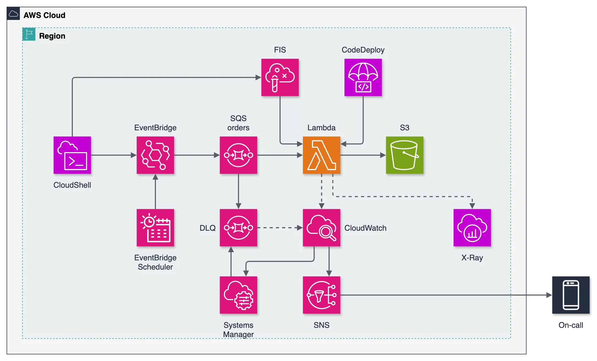

# Hands-on DevOps: Chaos Engineering (AWS FIS) and On-call Response (CloudWatch, SNS, OpsCenter)

Repository `devops-day-lab`.

**A small order pipeline on AWS that you break on purpose, watch, get paged for, fix, and then ship a bad release to.** One `sam deploy` gives you an EventBridge bus, an SQS queue with a dead-letter queue, one Lambda function, an S3 archive, a CloudWatch dashboard with five alarms, two AWS FIS chaos experiments, an SNS on-call topic, OpsCenter tickets, a Systems Manager runbook and a CodeDeploy canary. In 55 minutes you do what an on-call engineer does in a bad week.

[한국어 README](README.ko.md)



- **The app** is deliberately boring: EventBridge Scheduler puts 10 `OrderPlaced` events a minute on a bus, a rule sends them to an SQS queue, a Lambda function archives each order to S3. Three failed attempts and an order lands in the dead-letter queue.
- **You watch it** on a CloudWatch dashboard: invocations vs errors, p50/p95 latency, queue depth, an app metric written as an embedded-metric-format line, and the structured JSON logs. X-Ray tracing is on.
- **You break it** with AWS Fault Injection Service: one experiment fails every order for 4 minutes, another adds 3 seconds to every order. A separate blast-radius alarm stops any experiment that dead-letters more than 100 orders.
- **You get paged**: alarms publish to an SNS topic (email, optional SMS) and open OpsItems in Systems Manager OpsCenter with a severity and a category. Console Mobile App push is a 5-minute optional setup.
- **You fix it** by running a Systems Manager Automation runbook that moves the dead-lettered orders back to the queue.
- **You ship safely**: `scripts/release.sh on` deploys a version that crashes on every order as a 10% canary. The canary alarm fires and CodeDeploy rolls back before the on-call alarm notices.

Each person deploys their own copy into their own account. Nothing is shared.

## What you need

| | Where |
|---|---|
| AWS account | A sandbox account. Attach `iam/lab-policy.json` to the user or role you deploy with (see Permissions) |
| An email address | Receives the alarms. You confirm one subscription mail after the first deploy |
| Optional: a phone | SMS alarms. The script verifies the number in the SNS SMS sandbox with a one-time code |
| Optional: AWS Console Mobile App | Push notifications for alarms, set up by hand in AWS User Notifications |

## Install with AWS CloudShell (nothing to install locally)

1. Sign in to the AWS console and pick the Seoul region (`ap-northeast-2`). Another region works with `AWS_REGION=<region> ./scripts/setup.sh`.
2. Open [CloudShell](https://docs.aws.amazon.com/cloudshell/latest/userguide/welcome.html) (the `>_` icon in the top bar). It has the AWS CLI, SAM CLI and git, and uses your console login.
3. Run:

   ```bash
   git clone https://github.com/Gosorasora/devops-day-lab.git
   cd devops-day-lab
   ./scripts/setup.sh
   ```

The script does the following:
1. Asks for the on-call email and, optionally, a phone number in E.164 form (`+8210...`).
2. If a phone was given, registers it in the SNS SMS sandbox and asks for the one-time code SNS texts you.
3. Runs `sam deploy` with those values. No `sam build`: the function has no dependencies, so `src/` is packaged as is.
4. Prints the dashboard URL. Orders start flowing within a minute.

Confirm the "AWS Notification - Subscription Confirmation" mail. Until you do, no alarm reaches you.

The script is safe to re-run: press Enter at a prompt to keep the stored value. Re-running also sets `Bug` back to `off`.

## The lab

The participant guide is [docs/guide.md](docs/guide.md) ([한국어](docs/guide.ko.md)). A click-by-click console walkthrough with screenshots is [docs/walkthrough.ko.md](docs/walkthrough.ko.md) and the 55-minute presenter script is [docs/script.ko.md](docs/script.ko.md) (both Korean). The 55-minute path, with a 30-minute short path marked inside it:

1. **Deploy** (10 min): `./scripts/setup.sh`, confirm the mail, open the dashboard.
2. **Baseline** (10 min): read the dashboard, a Logs Insights query, the X-Ray service map. Know what normal looks like.
3. **Break it** (10 min): `scripts/chaos.sh start error`. Watch errors, then the dead-letter queue, then your inbox and OpsCenter.
4. **Respond** (10 min): read the OpsItem, find the cause in the logs, stop the experiment, run the redrive runbook, resolve the OpsItem, compute your MTTD and MTTR.
5. **Ship safely** (10 min): `scripts/release.sh on`. Watch the canary alarm fire and CodeDeploy roll back.
6. **Clean up** (5 min): `./scripts/teardown.sh`.

## Scripts

| Script | What it does |
|---|---|
| `scripts/setup.sh` | Asks for email and phone, verifies the phone in the SMS sandbox, runs `sam deploy`, prints the dashboard URL |
| `scripts/send.sh [N]` | The shop's "API": puts N `OrderPlaced` events on the bus (default 1) |
| `scripts/chaos.sh start error\|delay` / `stop` / `status` | Starts one of the two FIS experiment templates, stops every running experiment, lists experiments |
| `scripts/release.sh on\|off` | Deploys the broken (`on`) or healthy (`off`) consumer through the CodeDeploy canary |
| `scripts/redrive.sh` | Runs the runbook that moves dead-lettered orders back to the orders queue, then prints what is left |
| `scripts/teardown.sh` | Stops experiments, empties the bucket, deletes the stack |

## AWS services used

| Service | Role in the lab |
|---|---|
| Amazon EventBridge (bus, rule, Scheduler) | The event backbone and the load generator (10 orders a minute) |
| Amazon SQS | Orders queue plus dead-letter queue (3 attempts) |
| AWS Lambda | The consumer, invoked through the `live` alias, with X-Ray tracing |
| Amazon S3 | Archive of processed orders and the FIS fault-config drop point |
| Amazon CloudWatch | Dashboard, five alarms, Logs Insights, embedded metrics |
| AWS X-Ray | Traces and the service map |
| AWS Fault Injection Service | `aws:lambda:invocation-error` and `aws:lambda:invocation-add-delay` experiments with a stop condition |
| Amazon SNS | The on-call topic: email and optional SMS |
| AWS Systems Manager OpsCenter | OpsItems opened by alarms, with severity and category |
| AWS Systems Manager Automation | The `redrive-dlq` runbook (`sqs:StartMessageMoveTask`) |
| AWS CodeDeploy | `Canary10Percent10Minutes` with automatic rollback on the canary alarm |
| AWS User Notifications (optional) | Push notifications to the Console Mobile App |

## Cost

- **AWS FIS:** $0.10 per action-minute. Each experiment runs one action for 4 minutes, so about $0.40 per run.
- **OpsCenter:** $2.97 per 1,000 OpsItems.
- **SNS email, User Notifications, CodeDeploy for Lambda:** free. SNS SMS is charged per message.
- **Lambda, SQS, EventBridge, S3, CloudWatch, X-Ray:** inside the free tier for a lab this size.
- A full 55-minute run costs about $1. Run `./scripts/teardown.sh` when you are done; the load generator never stops on its own.

## Permissions

`iam/lab-policy.json` is what the deploying user or role needs. It is broad on the lab's services and limited to roles named `devops-day-lab-*` on IAM, which is appropriate for a sandbox account and not for a shared one. For an IAM user:

```bash
aws iam put-user-policy --user-name <user> --policy-name devops-handson --policy-document file://iam/lab-policy.json
```

The optional Console Mobile App push (AWS User Notifications) is covered by the same policy.


## Uninstall

```bash
./scripts/teardown.sh
```

OpsItems stay in OpsCenter until you resolve them. A verified SMS sandbox number stays verified.

## Project layout

```
src/consumer.py     the Lambda function (stdlib + the boto3 the runtime ships)
test_consumer.py    python3 test_consumer.py (no network, no boto3 install)
template.yaml       SAM template: the whole lab
scripts/            setup.sh, send.sh, chaos.sh, release.sh, redrive.sh, teardown.sh
iam/lab-policy.json permissions for the deploying identity
docs/               guide.md, guide.ko.md, walkthrough.ko.md, script.ko.md, screenshots/, architecture.png
DECISIONS.md        why things are the way they are (Korean)
```

## License

[MIT](LICENSE)
